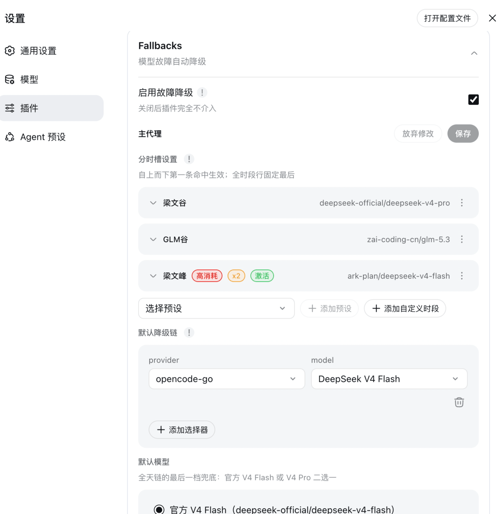

# dsh-llm-fallbacks

[English](README.md) | [中文](README.zh-CN.md)

[](https://www.npmjs.com/package/dsh-llm-fallbacks)
[](LICENSE)


[](https://dshfind.com/zh/plugins/omdsh-dev/dsh-llm-fallbacks?ref=badge)

dsh（DeepSeek Harness）的自动模型降级插件：当 agent 的模型请求持续失败（重试耗尽、权限错误、配额超限、限流 429）时，插件按当前角色的 fallback 链切换 provider/model，当前 step/turn 在目标模型上继续——任务不会因模型问题中断。

两个 dsh 前端均可用：**web** profile（设置 → 插件配置 → Fallbacks 卡片）与 **dsh-tui** 终端 profile（`/fallbacks` 会话诊断、`/fallbacks config` 回读、`/settings` 的 fallbacks 分区用于编辑）。

## 三项核心能力

### 自动模型降级

root 或 subagent，只要持续命中触发码，就沿自身链切到下一个可用 provider/model，step 继续运行。无需手动切换模型；在配置了内容之前，插件不做任何事。

- **触发**：`triggerCodes`（默认 `AUTH` / `QUOTA` / `RATE_LIMIT`）——**任何** dsh 失败码都可用，包括 `CONTEXT_WINDOW_EXCEEDED`（会降级到上下文窗口更大的候选）。可重试失败（5xx、`TRANSPORT`、`TIMEOUT` 等）先交给 llm-retry。
- **恢复**：失败或被切走的模型在 `cooldownMs` 内不再被选中，`revertPolicy: cooldown-expiry` 在冷却到期后回到主模型；可选的 `recovery: half-open` 模式（YAML-only）把这次回归改为证据驱动，而非定时器驱动。
- **保险丝**：`maxSwitchesPerStep` 限制单 step 的切换次数，`alwaysModeRetryCap` 限制 always 模式的重试次数——链式循环不会放大延迟。
- **可见性**：每次切换都写入 info 日志（from/to/role/reason），不存在静默切换。

→ [自动模型降级](docs/features.md#automatic-model-failover) · [上下文窗口降级](docs/features.md#context-window-aware-fallback)

### 峰谷无忧（分时切换）

分时槽按墙钟窗口轮换**生效 root 链**：每一行携带自己的 fallback 链，第一个窗口包含当前时刻的行将在下一个 root 请求取代全时段链；无行命中时，全时段链作为最后兜底。轮换是路由种子而非失败决策：不消耗冷却，也不影响失败降级（fallback switch）。



四个冻结的 UTC+8 预设（窗口是代码常量；存在预设行时 `tz` 锁定为 Asia/Shanghai）：

| 预设 | 窗口 |
|---|---|
| `liang-peak` | 周一至周五 09:00–12:00 与 14:00–18:00 |
| `liang-valley` | 其余所有 UTC+8 时间（梁高峰的补集） |
| `glm-peak` | 周一至周五 14:00–18:00 |
| `glm-valley` | 其余所有时间（GLM 高峰的补集） |

GLM Peak / GLM Valley 仅在配置了 `zai-coding-cn` 时才会出现在卡片选择器中。自定义行使用 `start` / `end`（`HH:mm`，可跨午夜）与可选 `days` 列表。

→ [分时槽](docs/features.md#time-slots)

### 角色化 subagent

subagent 的角色由分发提示词声明——Assignment 头部字段 `**Execute as**: <id>`；它与 `roles.list` 中已声明的角色 id 匹配。只有这个**已声明头部**才投递子代理的身份：`persona` 以 system-prompt 分区安装到子代理，子会话恰好写入一行 `[role: <id>]` 通知行，会话头部显示角色徽章。

角色**路由**是另一套解析，按四个有序阶段、先命中者生效——显式 `agentPreset` → **派发声明** `**Execute as**: <id>` 头部 → 规则 → LLM 自动匹配。只要子代理的分发提示词声明了 `**Execute as**: <id>`，该角色的 persona、`[role: <id>]` 通知行与徽章就会投递，**无论哪个路由阶段胜出**——更早的显式 `agentPreset` 可以把子代理路由成另一个角色，而身份载体仍属已声明头部。完全没有声明分发头部的子代理不会获得 persona、通知行与徽章，即使规则或自动匹配为路由解析出了角色。把解析到的角色链头作为子代理模型由插件发起、且带条件：宿主 `subagent-model-selection` 策略启用时，显式授权路由会被保留（跳过注入），注入的链头必须落在生效 allowlist 内——交集为空则不注入任何内容（[宿主策略](docs/features.md#host-subagent-model-selection-policy-dsh-012)）。

这一套同时覆盖**普通 subagent 分发与 Agent Team 队友**（`spawn_teammate`）：两者都是带着同一头部（由模型写入）经同一分发 seam 创建的子代理，不需要任何按机制区分的配置。

→ [角色化 subagent](docs/features.md#role-based-subagents)

## 快速开始

### 安装

**Desktop / Web 插件页**——在 DeepSeek Harness（Desktop 应用或 `dsh web` 会话）中打开侧边栏的**插件（Plugins）**页，点击**添加插件**，输入包名 `dsh-llm-fallbacks`，点击**安装**，然后按宿主的重启提示操作。该向导接受包名（即 npm 包名）、GitHub repo 或本地目录——registry 安装只需填包名。GUI 安装写入 `web` profile，与下方 `--profile web` 指向同一个 profile。

**CLI**——适用于脚本化环境或终端前端：

```sh
dsh plugin --profile web add dsh-llm-fallbacks      # web profile（设置 → Fallbacks 卡片）
dsh plugin --profile dsh-tui add dsh-llm-fallbacks  # dsh-tui 终端 profile
```

`dsh-tui` 没有自己的插件页，只能走 CLI。可用 `@<version>` 固定版本。registry 安装拉取**已构建包**（`dist/`），目标机器不执行构建。registry / git / 本地目录三种安装方式、卸载与 `--dump-config` 校验 → [docs/install.md](docs/install.md)。插件同时提供**本地化元数据**（Plugins 详情页的标题/描述，英文 + 简体中文）与**图标**——两者都在包内声明（`locale/*.json` + `icon.svg`），由宿主自动识别。

### 配置

插件的设置存放在共享的 `fallbacks:` 命名空间，可从三个界面编辑：

| 界面 | 说明 | 备注 |
|---|---|---|
| **Web 设置卡片** | 设置 → 插件配置 → Fallbacks | `fallbacks:` 命名空间的完整 GUI 编辑器，写入共享设置文档 |
| **`$DSH_HOME/settings.yaml`** | dsh 设置文档中的 `fallbacks:` 分区 | 共享的事实来源——与 web 卡片写入同一文件；任何环境都可读写，脚本化配置亦可 |
| **TUI `/settings`** | dsh-tui 设置界面中的 fallbacks 分区 | 需要 dsh-tui ≥ v0.8.5；简单键使用原生字段，复杂结构使用 JSON 文本字段 |

（`/fallbacks` 与 `/fallbacks config` 是诊断命令——只读视图，不是编辑入口。）最小配置如下：

```yaml
fallbacks:
  rootChain:               # 全时段链：前置项 = 降级链，末项 = 默认模型（官方模型）
    - anthropic/claude-3-5-sonnet
    - deepseek-official/deepseek-flash
  timeSlots:               # 可选：按墙钟窗口轮换生效 root 链
    - kind: preset
      preset: liang-peak
      chain:
        - anthropic/claude-3-5-sonnet
  roles:                   # 可选：先声明角色实体，再由规则引用
    list:
      - id: reviewer
        persona: Code-review subagents
        chain:
          - openai/gpt-4o-mini
        fallback: inherit-root
    rules:                 # 仅 subagent：规则永不匹配 root 请求
      - role: reviewer
```

三条要点：

- **没有功能开关**：只要配置了内容——非空 `rootChain`、至少一行 `timeSlots`、或一个已声明角色——插件才介入；空配置是完全的 no-op，Plugins 页的行开关是总开关。
- **全时段 `rootChain` 的末项必须恰好是一个官方模型**——`deepseek-official/deepseek-flash` **或** `deepseek-official/deepseek-v4-pro`（XOR）；前置项是降级链，优先进走。
- **分时槽与角色都是可选的**：第一个窗口命中的分时行会在下一个 root 请求取代全时段链；规则把 subagent 映射到已声明角色，且永不匹配 root 请求。

完整参考（字段、条目语法、选择器规则、迁移）→ [docs/configuration.md](docs/configuration.md)。

> **升级提示（破坏性变更）**：配置级 `enabled` 开关已**移除**——仍带 `enabled: true/false` 的存量分区可正常加载（该键被忽略并在下次保存时剔除），但开关不再有任何作用。若此前依赖 `enabled: false` 让插件保持静默，请改为清空该分区（或关闭 Plugins 页的插件行）。

### 验证

保存配置并重启会话，然后输入 `/fallbacks`——只读的会话诊断（来源、解析出的角色、链、最近的降级、冷却状态）。在 dsh-tui profile 下，`/fallbacks config` 会回读组合后的配置。

## 能力一览

- **自动降级**（root 与 subagent 通用）——命中触发码的 agent 沿链切换，step 继续运行。 → [详情](docs/features.md#automatic-model-failover)
- **上下文窗口感知降级**——`CONTEXT_WINDOW_EXCEEDED` 会切到窗口更大的候选；该切换是请求级的（不消耗冷却）。 → [详情](docs/features.md#context-window-aware-fallback)
- **峰谷无忧（分时槽）**——四个冻结的 UTC+8 预设或自定义窗口轮换生效 root 链。 → [详情](docs/features.md#time-slots)
- **角色化 subagent**——派发声明的角色为子代理带来 persona、通知行与徽章；链头注入受宿主策略约束。 → [详情](docs/features.md#role-based-subagents)
- **模型选择器中的 FallbacksChain**——选择 `FallbacksChain / Auto` 即把配置链作为 root 主模型；选择真实模型仍是仅降级。 → [详情](docs/features.md#fallbackschain-in-the-model-picker)
- **宿主子代理模型策略**——dsh 0.1.2 的 allowlist 是插件发起的所有 subagent 路由的硬约束。 → [详情](docs/features.md#host-subagent-model-selection-policy-dsh-012)
- **五个内置预设角色**——`reviewer` / `scout` / `security-reviewer` / `sonic` / `task`，随 apply 自动声明。 → [详情](docs/features.md#preset-roles)
- **dsh-tui 操作面**——`/fallbacks`、`/fallbacks config`，以及与 web 卡片等价的 `/settings` 分区。 → [详情](docs/features.md#dsh-tui-surfaces)

## 纯挂载

插件以**纯挂载**方式安装：bundle 插入 + client 注入 + 自有 gateway 通道（`/api/fallbacks/get|set|reset`）——不修改 dsh 源码、没有 postinstall，dsh 升级也无需重新打补丁。旧版打过补丁的安装残留补丁无害。

## 文档

| 文档 | 内容 |
|---|---|
| [docs/install.md](docs/install.md) | 桌面/Web 插件页 / profile 安装（web + dsh-tui）/ registry / git / 本地目录 / 卸载 / `--dump-config` 校验 |
| [docs/configuration.md](docs/configuration.md) | `fallbacks` 命名空间完整参考、选择器语法、示例 YAML、插件配置卡片用法、TUI 回读、行为说明、预设角色 |
| [docs/features.md](docs/features.md) | 能力参考：降级、上下文窗口降级、分时槽、角色化 subagent、选择器、宿主策略、预设角色、agent 预设、dsh-tui |
| [docs/repair.md](docs/repair.md) | 会话日志修复：拒载类别、`--apply` 发布、参数、退出码、有损 `--drop-legacy-events` |
| [docs/consumer-api.md](docs/consumer-api.md) | 开发者消费契约：库 API + 具名 `llm-fallbacks` 服务 + 角色种子、导出清单、生命周期、类型 |
| [docs/release.md](docs/release.md) | 发布流程：Trusted Publishing 配置、Release prep SOP、fragment 格式、回滚 |
| [docs/verification.md](docs/verification.md) | 验证记录（测试矩阵、bundle 层序、运行时契约、QA 门禁脚本） |
| [CHANGELOG.md](CHANGELOG.md) | 已发布变更，由 `.changes/` 的 fragment 汇总生成 |

## 许可

以 **MIT** 许可发布——见 [LICENSE](LICENSE)。版权与许可条款以 LICENSE 文件为准。
