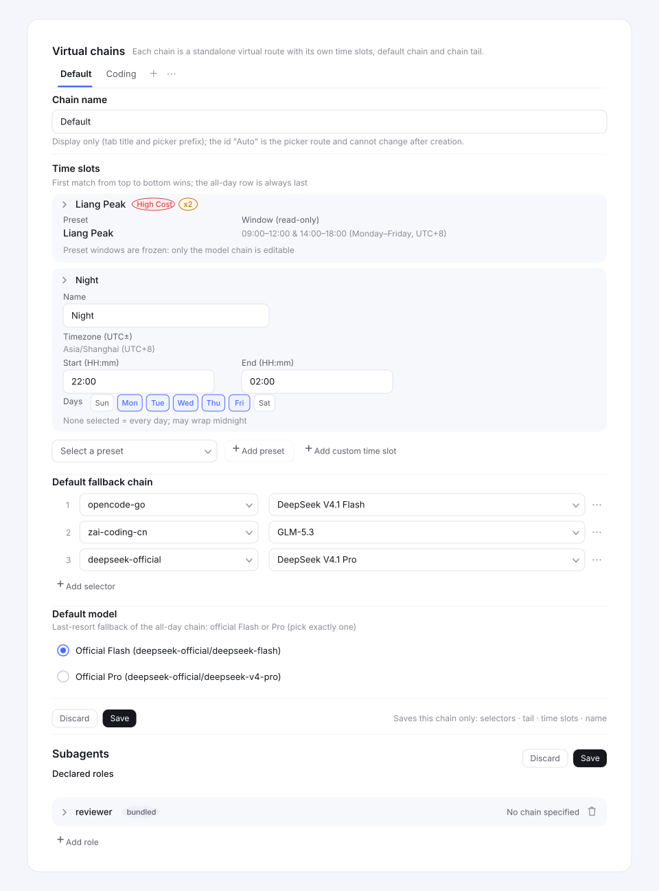

# Configuration Guide (`fallbacks` Namespace)

Plugin configuration lives in the `fallbacks` settings namespace. It can be edited in the dsh settings document (default `$DSH_HOME/settings.yaml`) or in the web settings GUI via **插件配置 (Plugin Settings) → Fallbacks card** — both read and write the same namespace. The card's reads/writes go through the **plugin's own gateway channel** (`/api/fallbacks/get` / `/api/fallbacks/set` / `/api/fallbacks/reset`) and do not depend on any settings-exposure mechanism of the dsh host; the `fallbacks` namespace not appearing in the host's describe exposure is by design. The plugin makes **zero local modifications** to the dsh source tree (pure mount: bundle row insert + client inject + its own gateway), so dsh upgrades never require re-patching.

## Named virtual chains

Since iter-20261108 (named virtual chains) the configuration follows the **named-chain model** — you only need to remember two things:

| Concept | In one sentence | Config location |
|----|--------|----------|
| Named chains | N independent virtual routes, each selectable as `FallbacksChain/<chain id>`, each carrying its own 默认降级链, 默认模型（链尾）and 分时槽 | `chains` |
| Roles | Declared identities (id/persona) with an OPTIONAL manual chain POINTER (「指定降级链」); absent = not specified = the child inherits the delegating agent's route | `roles.list[].chain` |

**Do not mix them up:**

- the chain `id` is the picker model id — renaming it would orphan every saved selection; only the `label` is editable in the card;
- a role `chain` is a **pointer into `chains[].id`**, never a chain definition — the plugin never picks a chain on its own;
- `'inherit'` stays a **reserved role id** (forbidden in `roles.list[].id`).

## Field overview

| Field | Type | Default | Description |
|---|---|---|---|
| `triggerCodes` | string[] | `['AUTH', 'QUOTA', 'RATE_LIMIT']` | Failures with these codes enter chain decision. A code that is NOT listed never switches chains inside that walk (its failure is forwarded verbatim), but the attempt is still booked — cooldown unless the code is request-scoped — so the next llm-retry re-entry starts past the failed head. Retryable failures (5xx / `RATE_LIMIT` etc.) are therefore retried with backoff by llm-retry and resume on the next candidate — **no extra `triggerCodes` entries are needed for 5xx** |
| `chains` | NamedChain[] | `[]` | **Named virtual chains** (one object per chain: `{ id, label, entries, timeSlots }`). `id` matches `/^[A-Za-z0-9][A-Za-z0-9-]{0,31}$/` (case-sensitive, unique) and doubles as the picker model id (`FallbacksChain/<id>`); `label` is the tab title + picker display prefix (display-only, freely editable); `entries` are 默认降级链 + 链尾 — the LAST entry must be exactly one official model (one of the four ids in [All-day chain tail](#all-day-chain-tail-默认模型-and-chain-默认降级链): `deepseek-account` / `deepseek-official` × `deepseek-flash` / `deepseek-v4-pro`); `timeSlots` are 分时 rows scoped to THIS chain. A non-conforming chain warns at startup and its walk refuses (`UNDISPATCHABLE_EFFECTIVE_HEAD`); the card/gateway reject it on save. **Empty `chains` = the plugin is inactive** — it is the ONLY first-run state; nothing pre-creates a chain |
| `roles.list` | Array | `[]` | **Block 2**. Declarative role-entity collection (id/persona + optional chain/fallback; entry fields in the table below). The id must match `/^[a-z0-9-]{1,32}$/` and be unique within the collection; `'inherit'` is a reserved word and **must not** be used as an id |
| `cooldownMs` | number | `300000` | Cooldown duration (milliseconds). Switched-away / failed models are not re-selected during the cooldown period |
| `revertPolicy` | `'cooldown-expiry'` \| `'never'` | `'cooldown-expiry'` | Primary-return policy after cooldown expiry: return to the primary model on expiry / keep the fallback model for the session |
| `recovery` | `'timer'` \| `'half-open'` | `'timer'` | Cooldown-expiry recovery mode: `'timer'` restores the preferred candidate when the cooldown expires (today's behavior, byte-identical); `'half-open'` leaves the route half-open for one logged probe line instead (see [Recovery mode](#recovery-mode-recovery-key)). Optional key — unset configs resolve to the default via the schema; YAML-only (no card / TUI control) |
| `maxSwitchesPerStep` | number | `8` | Per-request-walk safety valve: the switch-count cap for one walk (attempts ≤ cap + 1); beyond it the walk stops advancing and re-emits the last attempt's terminal error verbatim, preventing chain loops from amplifying latency |
| `presets` | `'bundled'` \| `'none'` | `'bundled'` | Preset-role switch: `'bundled'` declares the 5 bundled preset roles as seeded `roles.list` rows on apply; `'none'` disables declaration (zero declarations, zero writes from this switch). Optional key — unset configs resolve to the default via the schema. See [Preset roles](#preset-roles-presets-key) |
| `tz` | string | `'Asia/Shanghai'` | Config-level timezone for slot matching (standard `Intl` timezone rules, DST-safe). Not per-slot; no settings-card picker this iteration (YAML only) |

> The defaults are defined by `defaultFallbacksConfig` in `src/config.ts`; the card shows the default value next to numeric fields (`cooldownMs` / `maxSwitchesPerStep`) and the currently effective value for all other fields (which equals the default when unset).

> **Removed keys (0.2.2-rc.1)**: `alwaysModeRetryCap` and `roleAutoMatch` no longer exist (the always-mode cap is structurally unnecessary — every llm-retry re-entry resumes past a cooled head — and the LLM auto-match stage is gone with the request-override path). Both are reported by `detectLegacyKeys`, so a stored section that still carries them shows the migration banner and the startup warn; they are never read, and no successor key exists. Delete them by hand.

> **No feature switch (breaking change)**: there is NO config-level `enabled` key. The plugin registers and intervenes exactly when content is configured — a non-empty `chains` array — and even then only sessions whose model selection routes to `FallbacksChain/<chain id>` have a chain; an empty configuration is a pass-through exactly like an uninstalled plugin (no-op invariant). The **Plugins-page row toggle is the master switch** (disabling the plugin row stops the plugin entirely). A stored profile still carrying the removed `enabled: true/false` line loads cleanly — the key is tolerated, never read, and silently stripped from snapshots and saves (it is never re-persisted; there is no successor key and no migration entry) — but it no longer gates anything. If you relied on `enabled: false` to keep the plugin inert, empty the section instead.

### `roles.list` entry fields

| Field | Type | Required | Description |
|---|---|---|---|
| `id` | string | Yes | Role id: `/^[a-z0-9-]{1,32}$/`, unique within the collection; `'inherit'` is reserved and forbidden |
| `persona` | string | Recommended | Personality hint (free text, not validated); schema default is the empty string, absence does not block saving |
| `chain` | string | No | **The role's named-chain POINTER (「指定降级链」)**: a manually specified `chains[].id`. Absent/empty = **NOT SPECIFIED** — the plugin does not intervene and the child inherits the delegating agent's route. A pointer naming no declared chain earns ONE startup warn and behaves as NOT SPECIFIED (warn-not-crash) |
| `prompt` / `permissions` | string / object | No | **Reserved fields** (see next section) |

**Seeded rows**: a companion plugin may also auto-provision role rows through the service seeding API — a seeded role is a plain `roles.list` row (`{ id, persona }`, two keys only): seeds never write `chain` (a new seeded role has NO specified chain — NOT SPECIFIED), its persona can be reverted to the currently declared seed default via the service or the TUI `/fallbacks config revert-seed <role-id>` command (the web settings card offers no revert), and the card shows a source badge (`bundled` / the declaring set's name, `external` when unnamed / `User`). The card presents a seeded row as reference material, not editable config: no id field (the collapse title carries the immutable id, R2) and the persona renders as a read-only single-line brief with an expandable full view (no persona editor, no revert button), while the chain pointer stays editable. See [docs/consumer-api.md](consumer-api.md) → Role seeds. The plugin itself also auto-provisions 5 bundled preset roles on apply by default (see [Preset roles](#preset-roles-presets-key)) — same seed semantics, same source badge.

### `prompt` / `permissions` (reserved fields)

`prompt` and `permissions` (`allow` / `deny`) on `roles.list` entries are **schema-reserved fields**:

- **Writing them in YAML does not change this round's fallback behavior** — there is no runtime consumer this round;
- **The UI does not show them this round** — the Fallbacks card does not render these two fields;
- **Persona injection has since shipped — but from `persona`, not from these two fields**: a declared role's `persona` is installed on the child as a scoped system-prompt section at the `deployment:persona-prefix` slot, independent of routing, so a role with an empty `chain` gets its persona exactly like a chained one (see [docs/features.md](features.md#role-persona-on-the-child)). Being a section on the child's own context, it does not survive a host restart: a role child resumed afterwards runs without its role persona. `prompt` and `permissions` themselves still have no runtime consumer, so the tool filtering they were reserved for (`permissions.allow` / `deny`) remains the planned `fallbacks-explicit-role-tool` (roadmap item — no plan file yet).

## Preset roles (`presets` key)

The plugin ships **5 bundled omp-style preset roles** — generic subagent roles available out of the box: `reviewer` / `scout` / `security-reviewer` / `sonic` / `task`. Each persona is a concise instruction set distilled from the omp bundled agent prompts (`packages/coding-agent/src/prompts/agents/`, snapshot 2026-08-16) — a distillation, not a verbatim copy of a full prompt. The bundled set previously also carried `designer` and `librarian`; those two were removed (see the upgrade note below).

| `presets` value | Effect |
|---|---|
| `'bundled'` (default) | On `apply`, the plugin automatically declares the 5 preset roles through the role-seeds surface: they materialize as plain `roles.list` rows (`{ id, persona }`, two keys only) |
| `'none'` | No declarations, no writes — this apply round makes **zero** settings writes on account of this switch |

- **Idempotent**: re-declaring the same preset payload is a no-op — repeated `apply` / HMR / fiber swaps never duplicate rows and never drop an override.
- **Not gated by anything**: the self-declaration fires on apply unconditionally (it was never gated by the removed `enabled` switch, and that switch no longer exists) — even a content-less install materializes the 5 preset rows. The only zero-declaration path is `presets: 'none'`.
- **Upgrade behavior**: with the default configuration, the first `apply` after upgrading materializes the 5 rows into `roles.list`; each row shows a **source badge** in the settings card (existing capability — no extra configuration). Setting `presets: 'none'` stops further declarations but does **not** retract already-materialized rows — delete them by hand if you want them gone. **Honest limitation**: a hand-deleted row is re-materialized by the next `apply` (the plugin cannot distinguish "operator deleted" from "never existed").
- **Trim upgrade note (honest copy)**: versions before the trim also declared `designer` and `librarian`. After upgrading, rows saved by those earlier versions keep their persona and survive bundled declares untouched, but they are no longer in the bundled producer's slice — the plugin no longer has a live declaration for them. They now show source `user` (the `User` badge, no seeded-row treatment) only when no live producer still declares the id, **even though the operator never wrote those rows**. Only then are they ordinary editable config rows again (the label means "no live declaration", not "operator-written"); a companion's live declaration keeps them seeded and read-only with the winning producer's source label (`external` when unnamed, otherwise its registered set name), including when the mstar merge-preserve pattern copies currently seeded non-own ids verbatim. Delete them by hand if unwanted.
- **Per-row source**: every row carries a provenance label, read-time derived and never persisted — preset rows read back with source `bundled`; a row no live declaration covers reads `user`. The contract → [docs/consumer-api.md](consumer-api.md) → Per-row source.
- **Same-name operator rows are never overwritten**: a row the operator already defined keeps its persona — the declaration is flagged with a loud `logger.warn` (`'persona-source'` conflict, seed semantics unchanged) and the row still derives `seeded=true`, so the source badge is available. The preset persona is only ever applied to a brand-new row.
- The `presets` key is an **optional, YAML-only** switch — the settings card does not render a control for it this round. Unset configs resolve to the default through the schema; an invalid value (anything other than `'bundled'` / `'none'`) fails at config resolve, like `revertPolicy`.

## Entry syntax

**Chain entries** (the values of `chains[].entries` / `chains[].timeSlots[].chain`, ordered; a chain's LAST `entries` element is its 默认模型 — exactly one official model; the leading 默认降级链 entries are walked first. A time-slot row's `chain` is a **priority segment** walked before `entries`, so its own last element is just its last head candidate):

- `provider/model` — exact switch: switch to the specified model; the model id may itself contain `/` (e.g. NVIDIA NIM `nvidia/minimaxai/minimax-m3` or Hugging Face `org/repo`-style names);
- `provider/*` — keep the failed model id and switch the provider only; when the target provider lacks this model id the candidate is skipped (fuzzy near-match resolution is out of scope for this iteration).
- `provider/model@effort` (or `provider/*@effort`) — the same entry with a **pinned reasoning effort** for that hop, e.g. `anthropic/claude-3-5-sonnet@high`. The suffix is split off the LAST `@` of the model segment and must match `/^[a-z][a-z0-9_-]{0,31}$/`; any other suffix after an `@` stays part of the model id, so an exotic id keeps working. An entry WITHOUT a suffix sends no effort of its own and follows the session's selection (the card shows `跟随会话` / *Follow session*); a pinned effort **overrides** the session for that hop only and is dropped — never replaced by the session value — when the route does not list it (see [Effort and maxTokens adaptation](#effort-and-maxtokens-adaptation)). The pin never changes the route the entry names, so a pinned tail still conforms.

> **The old top-level `chains` key is history**: the v1 key died with the direction-C era and its role-key semantics are gone; the v2 `chains` array is the named-chain list. The `provider/*` wildcard stays a valid YAML entry in every chain editor — a hand-written `provider/*` entry reads back with a conversion hint and becomes an exact entry once a model is picked.

Whitespace padding: whitespace padding in a selector (e.g. `other/ gpt-4o`) is **preserved as-is** on save (the GUI does not rewrite user input); runtime parsing normalizes it (`parseSelector` tolerates whitespace), so the semantics are identical to the unpadded form.

Invalid/unknown entries (missing separator, empty segment, wildcard inside a model id, etc.) warn at save validation and **block the save** (card) or warn at startup (validation function); they never crash and never take effect. `*` is only valid as the entire model segment (the `provider/*` wildcard) and is rejected inside a model id. In a running dsh environment (with a model-catalog service) `*/*` never matches — the target provider has no `*` model catalog, so the existence probe skips that candidate.

## Role resolution and chain composition

**Role resolution** has ONE source, read at dispatch: the role the dispatch seam resolves from the child prompt's `**Execute as**: <id>` header (`resolveDeclaredRoleFromAssignment` in `src/subagents-seam.ts`), trimmed and looked up in the live declared-role map. An absent header, the reserved `'inherit'`, or a since-deleted role resolves to nothing, silently — **NOT SPECIFIED**: no role, no persona delivery, and (without a chain pointer) no plugin intervention.

**Chain composition** — a walk's candidate chain is the SELECTED chain's slot-effective entries:

- the session (root or child) is routed to `FallbacksChain/<chain id>`; the walk uses that chain;
- the first matching `timeSlots` row of THAT chain contributes its **priority segment**, then the chain's `entries` (default fallback chain + official tail) always follow — an entry already present in `entries` is not repeated (per chain; other chains are unaffected);
- a role's `chain` pointer decides the chain at DISPATCH time (the child is stamped onto `FallbacksChain/<role.chain>`), not per request.

Candidate filtering (skipped on hit): the same-as-current route, in cooldown (per agent, shared across chains), already failed in this walk, or the `provider/*` entry's target provider lacks this model id.

## Subagent role chain stamping

**Role resolution** runs inside the dispatch seam (at spawn), from the declared header above. The seam then stamps the role's named chain onto the child — `request.agentOptions = { provider: 'FallbacksChain', model: <role.chain> }` (rc.1 merges these over the parent's route when the child is created) — when **all four** conditions hold:

1. the `**Execute as**` header resolved a declared role;
2. that role's `chain` is non-empty AND names a declared `chains[].id` (an undeclared pointer behaves as NOT SPECIFIED — one startup warn, the child inherits the delegating agent's route);
3. the request carries **no** explicit `agentOptions.provider` / `agentOptions.model` — an explicit route is **authorized** and is never touched;
4. the backend is **local** — an external (acp) child keeps pure inheritance.

There is **no host-policy consultation anywhere**: the mapping is the user's STATIC config, never a model-authored route — no allowlist intersection, no `unprovable` branch, no `virtualRouteInjected` flag, no blocked-attempt records. The seam also does NOT check tail conformance: a declared-but-non-conforming chain is still stamped and the walk's own gate refuses it (one gate, in the walk). Stamping is **creation-time only** — a resume re-attaches to the child's own durable route and writes the role record only.

**Accepted degradation**: switches INSIDE a stamped child's chain are not filtered against any host allowlist — the chain is user-authored config, and every entry in it was explicitly written by the operator.

### Agent Team members

With the experimental Agent Team bundle enabled, ordinary delegation is replaced by `spawn_teammate` / `send_message`; a teammate's role is carried by the **same** `**Execute as**: <id>` prompt header — written by the model into its initial spawn prompt, because the spawn request has no role or persona field. `roster.spawn` creates the member through `ctx.subagents.startActivation`, so the teammate flows through the resolution above unchanged:

- **The header is the only role carrier.** A teammate whose prompt omits it, or names an id that is not currently declared, is NOT SPECIFIED — exactly like a normally delegated child without a header.
- **Names stay arbitrary (but unique inside one Team).** Any number of differently named teammates can carry the same role; there is **no name→role mapping**.
- **Persona and role notice follow the normal child contract**; the chain (if the role specifies one) is stamped at spawn. The persona is a scoped `deployment:persona-prefix` section on the child's own context and does not survive a host restart.
- **Non-local provider — two outcomes.** An external (acp) provider creates no local agent, so a normally delegated external child resolves its role but gets **no persona, role notice or badge**. A **teammate cannot use one**: roster.spawn always reserves a childId, and the runtime rejects a reserved id for a non-local provider (UNSUPPORTED_CAPABILITY), so member creation fails and no role is delivered.

### Effort and maxTokens adaptation


The walk never rewrites a seed config: before each dispatch it adapts only the per-attempt copy to the candidate's declared capabilities, read from the host's `resolveModelInfo(provider, model)` once per candidate per walk. Values are **dropped**, never clamped or aliased:

| Case | Result |
|------|--------|
| The attempt's ENTRY pins an effort (`provider/model@effort`) the candidate lists | the pinned effort rides the attempt — it replaces the session's own selection for that hop, chain head included |
| The entry pins an effort the candidate does not list | `reasoningEffort` is dropped for THAT attempt only: the hop runs on the route's own default, NOT on the session's value (a pin is not a preference) |
| The entry pins none, and the session's virtual selection names an effort the candidate lists | that effort rides the attempt |
| The entry pins none, and the selection names none | none is sent (the virtual pair owns no real route for an inherited effort to belong to) |
| The entry pins none, and the selection names an effort the candidate does not list, or the candidate declares no reasoning | `reasoningEffort` is dropped for THAT attempt only |
| The inherited `maxTokens` exceeds the candidate's disclosed `defaultMaxTokens` | `maxTokens` is dropped for THAT attempt only, so the route's own default applies |
| The probe is absent, throws, or returns malformed metadata | the request is dispatched unchanged (fail open) |

A drop is logged at **debug** level (`llm-fallbacks: parameter adaptation candidate=<provider>/<model> dropped=<control>`), because a served request with a smaller budget than the caller asked for is otherwise indistinguishable from a normal turn.

This is the same rule the retired `overrideConfig` path enforced by dropping a stale effort on a route change, now applied per candidate rather than once per request. Policy-independent either way.

**Reactive repair (after an explicit rejection)**: a disclosed capability is not always the truth — a route can declare no `defaultMaxTokens` at all and still reject the request (observed on `zai-coding-cn` for `glm-5.3-flash`: no configured cap, so the 384000 request reached the API and the provider answered 400). So when an attempt fails **before emitting output** with the adapter's own parameter rejection, the walk retries the SAME candidate **once** with that control removed:

| Rejection | Repaired when |
|-----------|---------------|
| `UNSUPPORTED_REASONING_EFFORT` | the attempt carried `reasoningEffort` |
| `INVALID_REQUEST` whose message names a `max_tokens` **range/validity** rejection (`max_tokens参数非法…[1,131072]`, `max_tokens: … invalid`) | the attempt carried `maxTokens` |

The repair is a request fix, not a chain switch: **no** cooldown, **no** failed-set entry, **no** `fallbacks/switch` reason and no switch consumed — the candidate stays available to the next walk. At most one repair per control per attempt, so a repaired attempt that is rejected again follows the normal rules (trigger-code swallow/advance, or verbatim forwarding). The message shape is deliberately narrow: prose that merely mentions the parameter (`prompt exceeds max_tokens budget`) is not a range rejection and is forwarded, not guessed at.

**Usage chunks on repair**: the rejected request's `usage` describes a request the provider refused, so it is **not** yielded — the walk buffers uncommitted `usage` until the attempt either produces output or ends, and a repair discards it. A repaired logical attempt therefore emits **one** `usage` chunk: the repaired attempt's own (same as an attempt that was never rejected). An attempt swallowed for a chain switch still emits its `usage`, because it is not re-streamed.

**Residual path**: `UNSUPPORTED_REASONING_EFFORT` on an attempt that carried no effort, a second identical rejection after its repair, and `INVALID_REQUEST` from any other cause (it is too broad — it also covers malformed request history) still end the turn after one attempt unless the operator lists the code in `triggerCodes`; the walk's default trigger codes are unchanged. A forwarded one is booked in the walk's failed set but cools no route (request-scoped), so no re-entry is pushed past that route.

## FallbacksChain in the model picker

Whenever the plugin is active (`chains` non-empty — conformance is NOT part of the gate), the plugin registers a virtual **FallbacksChain** provider with **ONE catalog row PER named chain** — the row's `id` IS the chain id, so the picker selection is `FallbacksChain/<chain id>`. Web and dsh-tui both see the rows because they share the same adapter catalog. Registration is an idempotent transition-reconcile on committed config snapshots: register when `chains` goes empty → non-empty, unregister on the reverse; a chain with empty or non-conforming `entries` still shows its row (conformance gates the delegate, not the row).

- **Picker label**: each row's `name` is live — `` `<chain label>: <head display name>[<slot>]` ``, e.g. `默认链: DeepSeek Flash[all-day]`; bare `<chain label>` when that chain's tail is non-conforming or its head is unresolvable. The host reloads the catalog on picker open, so labels refresh then.
- **Select-is-a-walk**: selecting `FallbacksChain/<id>` serves the virtual pair unchanged and the adapter's `stream()` WALKS that chain — the first attempt is the chain's first dispatchable exact `provider/model` (slot-effective), and a pre-output trigger-code failure advances within the same request. Unknown/deleted chain ids (a chain removed while a session still selects it) throw a synchronous `UNKNOWN_CHAIN` before any chunk — re-select a chain in the picker.
- **Misconfiguration surfaces at the request**: a non-conforming chain (tail not exactly one official model), an empty chain, a wildcard/malformed/self-route head, or a vanished runtime throw synchronously (`UNDISPATCHABLE_EFFECTIVE_HEAD` / `EMPTY_EFFECTIVE_CHAIN` / `LLM_UNAVAILABLE`) and the runtime normalizes them into one terminal error finish.
- **Real models get no chain**: selecting any real catalog model means the session is not on a virtual route — no walk, no cooldown, no switch; `llm-retry` is the only retry layer.
- **Metadata follows the head**: `resolveModel(<chain id>)` proxies that chain's effective head's model info (modalities / context window / reasoning) when resolvable, with a permissive default otherwise (never throws — also for unknown ids). `imageRequestPricing` resolves the same way.
- **DOCUMENTED DEGRADATION — retry policy**: the host captures `providerRetryPolicy` ONCE per provider at registration, so the virtual route can no longer mirror a per-chain head's policy. The adapter answers `undefined` and the host's own default applies — a head provider's custom `retryPolicy` (including `mode: 'always'`) stops applying on the virtual route. The one-provider-per-chain alternative was rejected (picker UX + per-chain register/unregister churn).
- **Stale selection after unregister**: if the rows disappear (plugin disabled) while a `FallbacksChain/<id>` route is the session selection, the host keeps showing it with `routable: false` — select a real model to continue.

## Time slots (分时切换)

Time slots are the wall-clock peak/valley model: each slot row — a frozen UTC+8 preset (Liang Peak / Liang Valley / GLM Peak / GLM Valley) or a custom window — carries its own entries, the first matching row becomes that chain's effective entries for the next request, and the chain's own `entries` stay as the last resort (see [docs/features.md](features.md#time-slots)).



The figure shows the shipped card's structure: a **tab per chain** (`＋` adds one, `⋯` renames the label or deletes the chain), the selected tab's Chain name (链名称) field, the per-chain blocks **Time slots (分时槽设置) → Default fallback chain (默认降级链) → Default model (默认模型)**, and that chain's own Discard/Save pair (hint: "Saves this chain only: selectors · tail · time slots · name"). The Subagents (子代理) section renders one collapsed role card per role with its own save pair. The card also has a collapsible Advanced options (高级选项) disclosure below the role list (not shown in this figure).

Time-slot rows are configured PER CHAIN (`chains[].timeSlots`) and rotate that chain's effective entries by wall-clock windows: the resolver (`resolveEffectiveChain` in `src/time-slots.ts`) walks the chain's rows top-to-bottom — the FIRST row whose window contains `now` (in the config-level `tz`, default `Asia/Shanghai`) wins and its `chain` becomes the **priority segment** walked before the chain's `entries` (an entry already in `entries` is not repeated); the default fallback chain and the official tail always follow, so every slot keeps its last-resort fallback. No match → the chain's own `entries` alone. A non-conforming `entries` tail keeps the rows inert (the delegate gate every slot surface reads). Two chains never share slot state: each resolves against its own rows/entries only, and the rotation log is keyed per (agent, chain).

**Copy split (never mix):** slot rotation is a **分时切换** / time-slot switch — a routing seed: it applies on the **next** root request (no mid-step preemption), is exempt from `cooldownMs` and does not count against `maxSwitchesPerStep`, and is mount-only (info log + card / `/fallbacks` status line; no durable `fallbacks/switch` event). The failure walk keeps **降级切换** / fallback switch and the conversation notice 模型已降级 / Model downgraded stays on the failure path only.

### Row shape

```text
{ kind: 'preset' | 'custom', preset?, start?, end?, days?, name?, chain }
```

| Field | Type | Rules |
|---|---|---|
| `kind` | `'preset'` \| `'custom'` | Required. Anything else is rejected on save (the resolver warns and skips at load) |
| `preset` | string | `kind: 'preset'` only — one of `liang-peak` / `liang-valley` / `glm-peak` / `glm-valley`. At most ONE row per preset id (duplicates are rejected on save, first row wins at load). Preset rows must NOT carry `start`/`end`/`days`/`name` — their windows are frozen code constants and their name is the frozen label |
| `start` / `end` | string (`HH:mm`) | `kind: 'custom'` only — strict 24h format. `end` is EXCLUSIVE; `start > end` wraps midnight |
| `days` | number[] | Custom only — 0=Sunday … 6=Saturday; omitted/empty = every day |
| `name` | string | Custom only — display name (shown in the settings card's collapsed rows and the `/fallbacks` status line); omitted = `custom start-end` |
| `chain` | string[] | Always required and editable (entry syntax below). A matched row's chain is the effective chain |

### Frozen preset windows (UTC+8)

| preset | Window (not user-editable) |
|--------|----------------------------|
| `liang-peak` | 09:00–12:00 **and** 14:00–18:00 (both clocks, Monday–Friday; ONE row) |
| `liang-valley` | all UTC+8 times that are not Liang Peak (complement of the peak) |
| `glm-peak` | Monday–Friday 14:00–18:00 |
| `glm-valley` | all other times (complement of GLM Peak) |

### All-day chain tail (默认模型) and chain (默认降级链)

A chain's `entries` end with its 默认模型: the LAST entry (the card's 默认模型 panel) must be **exactly one** official model — one of the four legal tail ids:

| Tail id | Card label |
| --- | --- |
| `deepseek-account/deepseek-flash` | Flash（账号） |
| `deepseek-account/deepseek-v4-pro` | Pro（账号） |
| `deepseek-official/deepseek-flash` | Flash（官方） |
| `deepseek-official/deepseek-v4-pro` | Pro（官方） |

Both DeepSeek providers are equally usable and the ACCOUNT pair is listed first (the preferred provider). Leading entries (the card's 默认降级链 block) are optional, ordered walk targets before that last-resort fallback. The card renders the tail as a pick-one grid over the ids whose provider is CONFIGURED (one provider configured → its two rows plus an "only this provider" line; neither configured → no rows plus the explanation, and the blocked-save error stands), and the rest as a selector list above it (UI order = walk order). The tail is compared by its parsed `provider/model` key, so a tail that pins an effort (`deepseek-official/deepseek-flash@high`) still selects its row and still conforms. On save the card and the gateway both **reject** a non-empty `entries` whose last entry is not an official model (no migration wizard; pick one of the four ids), while an EMPTY `entries` array is accepted by the gateway — such a chain still shows its picker row and its walk refuses (`EMPTY_EFFECTIVE_CHAIN`); the card additionally requires a tail before its own Save is armed. At load, a non-conforming tail earns ONE startup warn, that chain's slot rows stay inert, and a virtual-route request on it is refused (`UNDISPATCHABLE_EFFECTIVE_HEAD`), so nothing is dispatched on it.

**Retired id**: the previous `deepseek-official/deepseek-v4-flash` tail is no longer legal — the catalog dropped the model (its sibling `deepseek-v4-pro` is the legal Pro tail again, see below). A saved chain whose tail is `deepseek-official/deepseek-v4-flash` is now non-conforming: startup warns, time-slot rows and the virtual picker row go inert, and the card/gateway refuse to save it until a legal tail (Flash or Pro) is picked.

**Pro availability**: the 0.2.0-rc.2 official default catalog serves the Pro tail as `deepseek-official/deepseek-v4-pro` (alongside the default `deepseek-official/deepseek-flash`), and the settings card offers it as a selectable option — no disabled state, no availability caveat. A hand-written legacy `deepseek-official/deepseek-pro` tail was never catalog-served nor selectable: it reads back as a non-conforming tail (one startup warn, inert slot rows, unselected in the card) — no migration wizard; re-pick the tail as `deepseek-official/deepseek-v4-pro`. The plugin does not probe catalog availability: a chain containing `deepseek-official/deepseek-v4-pro` dispatches to it like any other exact entry, and on the virtual route the `stream()` walk starts at the first dispatchable exact head of the effective chain, so a chain with a working entry before Pro still routes to that earlier entry.

### Save rules (card + gateway)

The gateway (`/api/fallbacks/set`) and the card's pre-save validation apply the same guards: chain ids must match the id pattern and be unique (case-sensitive), a `label` is required, a NON-EMPTY `entries` must end with exactly one official model (an empty `entries` is accepted — the row registers, the walk refuses), preset ids must be known and unique per chain, preset rows carry no windows, custom rows need strict `HH:mm` bounds and 0–6 integer days, and every slot row needs a non-empty chain. Malformed values are rejected — they are never persisted. The card is stricter than the gateway in one respect only: its own Save stays disarmed until the 默认模型 tail is picked.

## Example YAML

The following configuration demonstrates the named-chain shape — two chains (one with 分时 rows) and a role pointing at the first chain (write it into `$DSH_HOME/settings.yaml`):

```yaml
fallbacks:
  triggerCodes:
    - AUTH
    - QUOTA
    - RATE_LIMIT
  chains:
    - id: Auto                   # Picker model id: FallbacksChain/Auto (case-sensitive, unique)
      label: 默认链              # Tab title + picker display prefix (display-only)
      entries:                   # 默认降级链 + 链尾
        - anthropic/claude-3-5-sonnet
        - deepseek-official/deepseek-flash   # LAST = 默认模型: one of the four official tails
        # - anthropic/claude-3-5-sonnet@high  # an entry may pin its own reasoning effort
      timeSlots:                 # 分时 rows scoped to THIS chain
        - kind: preset           # Frozen UTC+8 windows; only the chain is editable
          preset: liang-peak     # Monday–Friday 09:00–12:00 AND 14:00–18:00
          chain:
            - anthropic/claude-3-5-sonnet
        - kind: custom           # HH:mm, may wrap midnight
          name: 晚班
          start: '22:00'
          end: '02:00'
          days: [1, 5]           # omitted/empty = every day (0=Sunday…6=Saturday)
          chain:
            - openai/gpt-4o
    - id: night                  # A second chain: selectable as FallbacksChain/night
      label: 夜间
      entries:
        - deepseek-official/deepseek-v4-pro
  tz: Asia/Shanghai              # Config-level slot timezone (default Asia/Shanghai)
  roles:                         # Identities + an optional chain POINTER
    list:
      - id: reviewer             # unique id matching /^[a-z0-9-]{1,32}$/; 'inherit' is reserved
        persona: Code review subagent
        chain: Auto              # 指定降级链: children dispatched under reviewer mount FallbacksChain/Auto
      - id: cheap
        persona: Cost first
        # no chain → NOT SPECIFIED: the child inherits the delegating agent's route
  cooldownMs: 300000
  revertPolicy: cooldown-expiry
  recovery: timer                # Optional: 'timer' (default) | 'half-open'
  maxSwitchesPerStep: 8
```

Key points:

- There is no `enabled` key and no auto-created default chain: **empty `chains` = inactive** (the no-op pass-through); the picker rows appear only after you create a chain in the card (or YAML).
- A chain's LAST `entries` element is its 默认模型 — exactly one official model; the leading entries are the 默认降级链 walk.
- A role's `chain` is a pointer, never a chain definition: it names one `chains[].id`. The plugin never picks a chain on its own.
- The first matching `timeSlots` row is the priority segment; the chain's `entries` (default fallback chain + official tail) always follow it, de-duplicated. Each chain resolves independently.
- Switching only changes the provider/model routing of subsequent requests; it does not reset session context or tool state.
- Each chain-target model needs its own credentials and quota configured (costs/quotas can differ between providers).

## Migration mapping table (v1 two-block → named chains)

v1 two-block configuration (the `rootChain` + `roles.rules` era) is **upgraded automatically — in memory, at every config read**. Nothing is written to disk on load; your file keeps its v1 text until you save, and the next explicit save persists the v2 shape. The upgrade is exactly what the table below describes, applied by the plugin itself:

- `rootChain` + the top-level `timeSlots` array become **chain #0** — `{ id: 'Auto', label: '默认链', entries: <old rootChain>, timeSlots: <old rows> }` — so the `FallbacksChain/Auto` route you already selected keeps resolving. The label is display-only, so the 指定降级链 dropdown can never be misread as an auto mode.
- `roles.list[]` survive as identity rows (`id` / `persona` / the reserved `prompt` / `permissions`). A v1 **ARRAY** `chain` becomes **not specified** — the card's 指定降级链 select takes over, and any other member of the row (a foreign key) is preserved. `fallback` is dropped, as are `roles.rules`, `roles.default` and `enabled`.
- A config that already has a non-empty `chains` list keeps it; only the v1 leftovers are stripped. An empty `chains` next to a v1 `rootChain` is a profile that never had v2 content, so it is migrated (otherwise your chain would silently vanish).

If you would rather see it in text, the table below is the same transformation; hand-editing is optional, not required.

| Old (v1 two-block) | New (named chains) |
|----------------------------|-----|
| `rootChain: [...]` | The `entries` of one chain: `chains: [{ id: 'Auto', label: '默认链', entries: [...] }]` |
| top-level `timeSlots: [...]` | Move the rows into that chain's `timeSlots` (the row shape is unchanged) |
| `roles.list[].chain: [...]` (an inline array — the v1 ARRAY form) | **Delete the inline array**; write a pointer instead (`chain: '<a chains[].id>'`) or create a chain for it |
| `roles.list[].fallback: 'inherit-root' \| 'none'` | **Delete this field** — there is no root append any more; point the role at a chain that already ends the way you want |
| `roles.rules: [...]` (all rule matching) | **Delete the whole key** — rules are gone; a child's chain is decided by its role's `chain` pointer (declared via the `**Execute as**` header) or by pure inheritance |
| `roles.list[].id` / `persona` | Unchanged |
| `prompt` / `permissions` | Still schema-reserved; no UI and no runtime consumption; writing them in YAML does not change fallback behavior |
| (no old counterpart) chain `id` = anything | Ids are case-sensitive and MAY be uppercase (`Auto` is the conventional migrated default); `/^[A-Za-z0-9][A-Za-z0-9-]{0,31}$/` |
| (no old counterpart) role `chain` naming no declared id | ONE startup warn; behaves as NOT SPECIFIED (the child inherits the delegating agent's route) |

**Removed surfaces** (nothing to migrate — they are gone): role rules and their matching, per-role chain definitions, the host-policy sync (the card's sync button and the `subagentPolicy` wire field), the card's 运行状态（只读） block, and the General page status row.

**Accepted degradations** (stated, not hidden): the virtual route's `providerRetryPolicy` returns `undefined` (the host's own default applies — a head's custom policy stops applying on the virtual route); switches inside a stamped child's chain are not host-allowlist-filtered (the chain is user-authored config); and the upgrade is in memory only — the plugin never rewrites your file, so an unsaved profile keeps its v1 text (and re-migrates identically on every load).

## Three-channel legacy notice

After an upgrade, legacy-format configuration is **upgraded in memory** (see the migration section above) and, while the file still holds v1 text, flagged through **three channels**. Loading does not change your file — the banner is informational, and an explicit save is what persists the v2 shape (see the end of this section).

1. **UI banner** (informational — `role="status"`, no error tone): the card renders it at the top of its body when the `get` / `set` / `reset` response carries a non-empty `legacyKeys`, with the actual field list in `{keys}`:
   - zh: 「检测到旧格式字段（{keys}）：已自动升级为命名链——原默认降级链成为第 0 条链「默认链」，角色与人格保持不变，旧的角色数组链已置为「未指定」（可在下方重新指定）。保存一次即可固化；插件不会主动改写你的配置文件。」
   - en: "Legacy fields detected ({keys}): automatically upgraded to named chains — your previous default chain became chain #0 「默认链」, roles and personas are unchanged, and old per-role chain arrays now read as "not specified" (re-attach them below). Save once to persist this; the plugin never rewrites your config file on its own."
   `{keys}` lists each detected key once. The banner does not block editing and does not touch disk by itself.
2. **Startup warn** (shipped): on plugin startup / config read, detected legacy fields are reported via `logger.warn` — `apply()` detects them through `detectLegacyKeys`, and the `legacyKeys` pipeline reports synchronously; the three channels are closed.
3. **This document's migration table**: the "Migration mapping table" section above is the reference for rewriting by hand.

**What a save does.** An explicit save (the card's Save, `/settings`, or any gateway `set` / the service's seed write) does not merely merge, and it is what turns the in-memory upgrade into stored configuration:

- it **writes the migrated `chains` array** in the same settings call that removes the v1 fields (the `chains` set is ordered before the `unset`s, so a section that carried a convertible v1 chain is never left with neither shape — a section with no `rootChain` / `timeSlots` has nothing to convert and nothing to lose). Materialization happens only when the stored section has no usable `chains` — absent, or an empty array next to a v1 `rootChain` — and never when the patch supplies `chains`; a stored non-empty `chains` is left byte-identical, foreign members included. That is what keeps a partial save safe: changing only `cooldownMs` from a v1 profile leaves the section self-sufficient v2, chain #0 with its entries and tail intact;
- it **strips the v1 fields** from the patch AND deletes the ones already in the persisted section — `rootChain`, the top-level `timeSlots` array, `roles.rules`, `roles.default`, `enabled`, and each `roles.list[]` row's `fallback` plus the v1 ARRAY form of `chain`;
- everything else is preserved: unrelated configuration, foreign keys written by other tooling, and every surviving role member.

So one save is the supported way to clean a v1 section — no YAML surgery required. The guarantee is scoped to what the writer does: when the stored section carries a convertible v1 chain, the migrated chain is written together with the v1 removals, so a partial save never loses it; a patch that supplies `chains` is respected verbatim (the writer then does not touch that array). Every other key follows the patch: values the patch names are written, values it does not name are left as stored, and the v1 fields listed above are deleted. The plugin still never rewrites your file on its own.

## Web plugin-config card usage

- **Entry**: web settings GUI → Settings → **Plugin Settings** page → **Fallbacks card** (rc.7 keyed slot: key `fallbacks`, the settings namespace the card edits, rendered after the bash / agent-loop / web-search / advisor cards in registration order; the card replaces the old standalone Settings navigation page).
- **Always-available card, no feature switch**: the card renders its form in any state — first open, loading, error — with **no feature switch** (the config-level `enabled` key is removed; the Plugins-page row toggle is the master switch). Its sections are Virtual chains (虚拟链) / Subagents (子代理) / Advanced options (高级选项): the chain tab strip below is the card's shape, role cards start collapsed, and Advanced options (高级选项) is a collapsible disclosure (see the bullets below). The config comes from the gateway channel `get` (`present` when it succeeds); when `get` fails / the channel is unreachable, the informational notice renders atop the form and the card stays the usable last-known skeleton (failures are reported truthfully, see below).
- **Legacy banner**: a non-empty `legacyKeys` in the `get` response → a migration banner (zh/en) renders at the top of the card body, pointing at this document's migration table; it does not block editing or touch disk.
- **Readable labels**: enumerable config items show readable labels instead of raw enum values — `RATE_LIMIT` → "Rate limit (429)", `QUOTA` → "Quota exceeded", `AUTH` → "Auth / permission failure"; `cooldown-expiry` → "Return to the primary model", `never` → "Keep the fallback model (until session end)". Numeric fields show the default value beside them; other fields show the currently effective value (the default when unset). The **Advanced options** (高级选项) group (`triggerCodes` / `revertPolicy` / `cooldownMs` / `maxSwitchesPerStep`) is a collapsed-by-default disclosure, forced open in a read-only view (`!writable`).
- **虚拟链 group — TAB-PER-CHAIN (the frozen mockup)**: one underline tab per chain on the 0.5px l2 hairline — the active tab's label renders in label-primary with a 2px brand underline; a dirty tab shows a pip, a tab with a validation error a red `!`. A `＋` button adds a chain (a fresh unique id is generated; the label is set via the tab); a `⋯` button opens the chain menu — rename the **label** (the id is immutable and shown in the menu so a rename can never orphan a saved picker selection) and delete the chain (at least one chain remains). Many tabs scroll horizontally with edge fades. The tab body carries the SHIPPED block order **分时槽设置 → 默认降级链 → 默认模型（链尾）** — 分时 rows as a compact per-row disclosure (the collapsed row prints the slot's window summary plus its up/down/delete actions; expanding it shows only that row's model chain, and a custom row edits name / start / end on one line), 默认降级链 as the provider/model/**reasoning-effort** selector list (the third select offers `跟随会话` plus the model's catalog tiers, and a model without reasoning metadata renders a disabled `无`), 默认模型 as the pick-one official-tail grid over the four legal ids (account pair first, filtered by the configured providers) that owns the LAST entry — plus a **per-tab Discard/Save** footer that writes ONLY that chain (a sibling chain's dirt never arms this Save, and validation errors render under their owning block).
- **Empty state**: with no chains the tab strip is replaced by the empty-state notice (no `FallbacksChain/*` rows appear in the picker) and a "create the first chain" button.
- **roles.list area (子代理)**: one role card per role — starts collapsed to id + its specified chain route (`FallbacksChain/<id>`, or `未指定降级链`); expanded shows id (format-validated: `/^[a-z0-9-]{1,32}$/`, unique, `inherit` reserved), the **指定降级链** select (未指定（沿用 dsh 默认） / `<label>（FallbacksChain/<id>）` per declared chain), the persona (multiline for ordinary rows; a read-only brief with an expandable full view for seeded rows, source badge on the header), and a delete button; an "Add role" button. `prompt` / `permissions` are **not rendered this round**. There are NO rule rows and NO per-role chain-entry editors.
- **Pre-save validation (blocks the owning save)**: chain id format/uniqueness, missing label, invalid selectors, per-chain slot guards, **the 默认模型 tail must be exactly one official model**, and role id checks → the error renders under the OWNING block (and arms the tab's `!` mark); only a passing validation writes via the gateway `set` (the gateway applies the same guards).
- **Legacy banner**: a non-empty `legacyKeys` in the gateway responses renders the migration banner at the top of the card, pointing at this document's migration table; it does not block editing or touch disk.
- **Removed from the card**: the 运行状态（只读） status block (and with it the client switch-history read), the host-policy status area and its sync button, the roles.rules editor, and the per-role chain-entry editors.
## TUI readback (dsh-tui profile)

In a terminal (`dsh-tui`) profile the plugin's write surface is the **`/settings` screen**: with **dsh-tui ≥ v0.8.5** (commit `c51661f` or later on `main`; the `tuiSettingsSections` seam shipped in v0.8.0, the groups shape + validation in v0.8.5; reference dsh-TUI `main` `2747b87`) the plugin registers a **fallbacks** section with **full parity to the web Settings → 插件配置 → Fallbacks card** — booleans/numbers/selects use native field kinds, complex structures (`chains` — ONE JSON field covering every named chain with its entries and per-chain slot rows — and `roles.list`, whose rows carry the chain POINTER) are JSON text fields, `triggerCodes` is a comma-separated text field, and `tz` a plain text field. Complex-field parsing mirrors the gateway validation (invalid JSON / non-conforming chain / malformed time-slot row → draft invalid → save blocked; a blank draft stages a `clear` that re-inherits the composition layer). On an older dsh-tui the section is absent and file editing remains the only TUI surface. Configuration also lives in the same files as everywhere else and is read back through the command:

- **Where config lives**: the shared `$DSH_HOME/settings.yaml` (`fallbacks:` section — the same file the web card writes) for global settings; the profile patch layer `~/.dsh/profiles/dsh-tui/cordis.patch.yml` (plugin-row `config:` overrides) for dsh-tui-specific values. The namespace itself is not TUI-specific — the composed config the TUI reads is the same composed config the runtime uses.
- **Readback**: `/fallbacks config` prints the composed `fallbacks` namespace — first line `Fallbacks 配置: 已启用` / `未启用` (the command renders in its default locale `zh`, like the rest of `/fallbacks`; the en dictionary mirrors the same line as `Fallbacks config: enabled` / `disabled`), then trigger codes, the named chains (one line per chain: `id (label): entries | slots: N — …`, long lists truncated with `…`), timezone, roles (`N — id (specified chain: <pointer>)` per role, long lists truncated with `…`), cooldown, revert policy, max switches per request walk (printed as `Max switches per request walk` / `单次请求行走最大切换`), presets, and edit hints pointing at `/settings` (file editing still documented). Bare `/fallbacks` stays the session diagnostic (origin / role / chain / current time-slot winner — 分时 side — / recent **fallback switches** — 降级 side — / cooldown) — the two surfaces are distinct from their first line.
- **Action command**: `/fallbacks config revert-seed <role-id>` restores a seeded role's persona to its declared seed default and prints the outcome — the web settings card presents seeded personas read-only (no revert affordance), so the command is this action's only surface.
- **Menu + completion**: `/fallbacks`, `/fallbacks config` and the `config` → `revert-seed` leaf appear in the TUI `/` menu with subcommand completion when the profile carries the `tuiCommandTrees` service (the `dsh-tui-command-trees` bundle row; the shipped dsh-tui bundle has it).

Installation for the dsh-tui profile → [docs/install.md](install.md) §6.

## Behavior notes

### Trigger conditions

A walk runs on a session whose model selection routes to `FallbacksChain/<chain id>` (the root agent by selection, a subagent by the role-chain stamp), with configured content and a resolvable candidate chain; the chain advances only on a failure code ∈ `triggerCodes` (default `AUTH`/`QUOTA`/`RATE_LIMIT`) that arrives **before the attempt emitted any output** (a `usage` metadata chunk is yielded but never commits the attempt):

- `AUTH` / `QUOTA` are non-retryable codes and reach the walk as the attempt's own terminal finish, with no backoff in between;
- retryable codes such as `RATE_LIMIT` and 5xx are first retried with backoff by llm-retry; each retry re-enters the walk as a fresh request, which starts past the cooled head;
- a failure whose code is not in `triggerCodes` is forwarded verbatim, taking the llm-retry or original-error path — the attempt is still booked first (failed set + cooldown, unless the code is request-scoped), so an llm-retry re-entry resumes past that head instead of re-dispatching it.

### Chain walk

One walk per `stream()` call of the selected chain's `FallbacksChain/<chain id>` route (`src/chain-walk.ts`):

1. **Start**: resolve the SELECTED chain (the `options.model` argument IS the chain id — an unknown id throws `UNKNOWN_CHAIN` synchronously) and its slot-effective entries; throw `UNKNOWN_CHAIN` / `EMPTY_EFFECTIVE_CHAIN` / `UNDISPATCHABLE_EFFECTIVE_HEAD` / `LLM_UNAVAILABLE` synchronously when no attempt can start. Every walk requires its own chain's tail to be conforming — there is no origin split.
2. **First attempt**: the chain head — or, when cross-call memory has the head on cooldown, the next surviving candidate (the llm-retry re-entry contract). A chain whose candidates are all cooled still attempts the head, so a request is never left without an answer.
3. **Per attempt**: the request is adapted to this candidate (effort / `maxTokens` dropped when it cannot serve them, unchanged when the probe is absent or unreadable), then nested `llm.stream({ ...adapted, provider, model })`, every chunk yielded as it arrives. The first **output** chunk commits the attempt, and the flag latches — `usage` is the only chunk that never commits it (passthrough metadata adapters emit before the terminal finish). Everything else commits, a block **start** included: switching after a block has opened would pour the next candidate's deltas into this attempt's partial block, which assembly drops. So a pre-output trigger failure that follows any block start is forwarded, not switched (accepted residual).
4. **On an uncommitted parameter rejection**: repair instead of switching — retry the SAME candidate once with the rejected control dropped (`UNSUPPORTED_REASONING_EFFORT` → `reasoningEffort`, a `max_tokens`-range `INVALID_REQUEST` → `maxTokens`), one `info` line per repair, no cooldown and no failed-set entry. The repaired attempt returns to these rules.
5. **On an uncommitted trigger-code failure**: swallow the finish, add the route to this walk's failed set, cool it down (except the context-window rejection — the one request-scoped code on this path), log the switch line (from/to/role/reason/candidates) and advance — until `maxSwitchesPerStep` switches are spent.
6. **Otherwise**: forward the attempt's finish verbatim and end the walk — a normal finish, an aborted finish, a non-trigger failure, any failure after commit, or an exhausted chain / spent cap (the last attempted failure is re-emitted). A FAILED attempt is booked at this boundary before its finish is delivered (failed set + cooldown unless the code is request-scoped), so a forwarded failure cools its head exactly like a swallowed one.

Exactly one terminal `finish` chunk is emitted per walk, no attempt's provider is ever `FallbacksChain` (recursion guard), and a walk never writes a durable `fallbacks/switch` event (issue #52) — the info log is the record.

### Cooldown and returning to the primary

A switched-away / failed model is not re-selected within `cooldownMs` (cooldown and the walk's own failed-candidate set are separate suppressions); with `cooldown-expiry` the model can be re-selected after the cooldown expires (return to primary); `never` does not return within the session (infinite cooldown).

### Recovery mode (`recovery` key)

`recovery` selects how an expired cooldown brings the route back — `'timer'` (default) or `'half-open'`:

- **`'timer'` (default)** — today's behavior, byte-identical: when the cooldown expires the model is re-selected as the preferred candidate (return to primary, subject to `revertPolicy`).
- **`'half-open'`** — evidence-driven recovery: when the cooldown expires the route is **not** restored as the preferred candidate. It goes **half-open**: while the episode is unresolved, every real user request routed to it is admitted normally — exactly as under `'timer'`, there is no admission limit. The episode's **one logged probe** is a single info log line (`llm-fallbacks: agent "…" half-open probe …`; the `probeLogged` marker) emitted for the first admitted request; later admissions route silently. The probe is a normal user request through the existing chain — no synthetic health checks, no background traffic. An **observed completion** on that route closes the circuit — the entry is cleared and the preference is fully restored (restoration is evidence-backed, not timer-backed). This holds whether or not a decision read has already marked the route half-open: a completion observed **after the cooldown lapsed** closes the circuit directly (a manual re-selection of the route, or a route no failure walk ever consulted because the current route kept succeeding), while a completion observed while the cooldown is **still active** is ignored — a stale in-flight success never cancels a fresher suppression. A **cancelled** (interrupted) completion is neutral: it neither closes nor fails the circuit, so the route stays half-open for the next probe. A probe failure re-suppresses the route with an **escalated** duration and the request falls over per the usual switch-away path, consuming the normal `maxSwitchesPerStep` budget.

**Escalation**: consecutive failures multiply the suppression duration by **2** per failure, capped at **1 hour** — `cooldownMs` → 2× → 4× → … → 1 h (the default `300000` escalates 5 m → 10 m → 20 m → 40 m → 1 h → 1 h …). The first failure of an episode is the flat `cooldownMs`; escalation changes the suppression **duration only**, never the per-walk switch count (`maxSwitchesPerStep` is untouched). If `cooldownMs` is at or above the 1-hour cap, escalation is inert (every suppression is already the cap) — `validateFallbacksConfig` warns about this at startup.

**Interaction with `revertPolicy`**: `revertPolicy: 'never'` makes the half-open mechanism entirely inert — the infinite cooldown never expires, so no probe is admitted and nothing escalates.

**Session-scoped state**: half-open flags and escalation counters are in-memory and session-scoped (the same lifetime as the cooldown store) — a restart resets every route to a flat first cooldown.

**YAML-only discovery**: `recovery` is a YAML-only key — the settings card and the TUI `/settings` section render no control for it, and `/fallbacks config` prints no `recovery` line (default-mode output is byte-identical). Machine readback flows only through the gateway `get` passthrough. Set it in `$DSH_HOME/settings.yaml` (or the profile patch layer). While a route is half-open, `/fallbacks` shows a marker row `{key} half-open (awaiting recovery probe)` instead of a suppression time.

### Safety valve

The failed-candidate set and the switch count are **walk-local**: they exist for the duration of one `stream()` call. Beyond `maxSwitchesPerStep` the walk stops advancing and re-emits the last attempt's terminal error verbatim (original code and message preserved), so a chain loop cannot amplify latency. Cross-call memory is the cooldown/recovery store only.

The retired `alwaysModeRetryCap` has no successor and no reason to exist: under the walk, every llm-retry retry is a fresh request, and a route-scoped failure has already cooled the head, so an always-mode retry loop advances through the chain by construction instead of pinning a failing route.

### No-op invariant

With no configured content (empty `chains` — the only first-run state), or a session not routed to any `FallbacksChain/<id>`, or no `triggerCodes` hit, or an empty/undispatchable chain, or an exhausted chain, or the switch cap spent: the plugin contributes nothing — the request and session event stream are identical to an uninstalled plugin, and no `fallbacks/switch` events are produced.

### Relationship with llm-retry

This plugin **does not modify** llm-retry's or providers' `retryPolicy`, and it registers no listener on the request waterfalls — llm-retry owns the request-error waterfall exclusively. The two compose through the walk: a retryable failure reaches this plugin only as llm-retry's re-entry, and that fresh request starts past the cooled head. The virtual row's `providerRetryPolicy` returns `undefined` (documented degradation), so the host's own default applies — a head provider's custom `retryPolicy` does not apply on the virtual route. On plugin unload (HMR/dispose) the injected walk unloads with the fiber and all per-agent state is cleared entirely — no residual state.

### Agent presets (plugin composition)

Agent **presets** are a dsh mechanism for composing plugins — a declarative child-plugin entry list applied as a set, carrying **no** model fields of their own. The fallbacks plugin needs no preset-specific configuration: a preset that includes the `dsh-llm-fallbacks` plugin row gives that preset's sessions the same chains/roles configured for the plugin — the plugin (and therefore its virtual `FallbacksChain/<chain id>` rows) exists **wherever the plugin's row is mounted**, and a session that selects one of those rows gets that chain. Two caveats:

- **A user preset override replaces the entire child list** (no merge): a preset that omits the fallbacks row silently unmounts the plugin for sessions using that preset. Restate every plugin row you want to keep.
- **Preset-scoped chain configs are possible by mounting the row inside a preset**: the plugin row's `config:` overrides in the preset composition produce a chain configuration that applies to that preset's sessions only (patch rows replace the whole `config`, so restate every field).

The plugin's own settings-namespace chains stay the sanctioned pattern for model routing — dsh's own `subagent-model-selection` policy works the same way (a settings namespace consumed by a tool package), and presets own no model config.

### AUTH triggers and `deepseek-account` routes

Since dsh 0.2.0-rc.2, account-provider credentials expire on an inference 401 and rejected tokens sign the session out (host-side account work). An **AUTH-triggered fallback away from a `deepseek-account` route** therefore now coincides with the host's own credential-expiry/sign-out handling — the plugin's switch-away-and-cooldown semantics are unchanged and aligned with it: the failure walk moves the session to the next candidate (or the primary after cooldown), while the host refreshes or re-prompts for credentials on its side. No plugin configuration is needed; listing or omitting `AUTH` in `triggerCodes` behaves as documented above.
